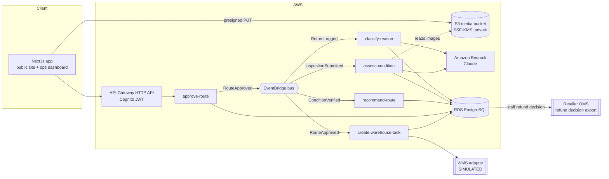

# ReturnRoute architecture

ReturnRoute runs on AWS. Amazon S3 stores inspection images and documents. Amazon Bedrock runs the classification and summary models. Amazon RDS for PostgreSQL is the system of record for returns and inventory. AWS Lambda functions, triggered through Amazon EventBridge, run the processing workflow. The deployable template is [`infra/template.yaml`](../infra/template.yaml).

## Workflow and where people are involved

| # | Stage | Who / what | Writes | Can it change stock, refunds or disposal? |
|---|---|---|---|---|
| 1 | Intake | Associate scans the parcel. `classify-reason` (Bedrock) categorises the free-text reason | `returns`, `reason_classifications` | No (used for analytics only) |
| 2 | Product identification | Associate confirms the barcode match and serial number | `returns.sku` | No |
| 3 | Inspection | Inspector adds notes, a checklist and images (uploaded straight to S3) | `inspections`, `inspection_media` | No |
| 4 | Condition suggestion | `assess-condition` (Bedrock, vision) | `condition_suggestions` (advisory) | **No.** The table has no route or action columns |
| 5 | **Condition verification** | **Inspector confirms or overrides the grade** | `condition_verifications` | No |
| 6 | Recommendation | `recommend-route` runs the deterministic rules engine on the *verified* grade | `recommendations` | No. It is a proposal only |
| 7 | **Staff approval** | **Inspector or supervisor approves through `approve-route`, which checks role and rules** | `decisions`, `refund_decisions` | Records a binding decision and the staff refund decision |
| 8 | Warehouse task | `create-warehouse-task` sends the task to the WMS (simulated) | `warehouse_tasks` | Creates a task |
| 9 | Inventory adjustment | Posted only after the task is done | `inventory_adjustments` | Yes, and only with a named approver and a completed task |

### How the safeguards are enforced

AI output is advisory, and the system enforces this in three independent places:

1. **Rules engine** ([`recovery.ts`](../web/src/lib/engine/recovery.ts)):
   - Without a human-verified grade, the engine returns `FURTHER_INSPECTION` (rule G-01).
   - Battery products need a passed safety check (S-01).
   - Disposal and high-value items need a supervisor (A-01, A-02).
   - Every recommendation carries a rule trace and a per-route value breakdown.
2. **API** ([`approve-route.ts`](../web/src/lambdas/approve-route.ts)): this is the only path that creates a decision. It checks:
   - the caller's role (from a Cognito JWT, looked up in `staff`)
   - that the grade was verified
   - that the route is permitted
   - that an override comes with a reason
3. **Database** ([`db/schema.sql`](../db/schema.sql)): enforced with constraints and a trigger.
   - A recommendation can't name a non-quarantine route without a `verification_id`.
   - `decisions` must name a staff approver. Associates can't decide. Only supervisors can choose `RECYCLE`. An override needs a note.
   - `inventory_adjustments` need an approved decision, a named approver and a **completed** warehouse task (enforced by a trigger).
   - `audit_events` is append-only.

These were tested against PostgreSQL. Each prohibited insert is rejected by a constraint or the trigger.

**Refunds:** ReturnRoute never issues payments. The staff refund decision is recorded in `refund_decisions` and exported to the retailer's order management system, where their existing controls apply.

## Bedrock usage

The Bedrock adapter is in [`bedrock-core.ts`](../web/src/lib/ai/bedrock-core.ts). It uses the Anthropic Bedrock SDK (`AnthropicBedrockMantle`) with the model set by `BEDROCK_MODEL_ID` (default `anthropic.claude-opus-5-5`).

| Task | Input | Output (schema-validated JSON) | Effort |
|---|---|---|---|
| Reason classification | Customer text, wrapped as data | `category`, `confidence`, `signals[]` | low |
| Condition suggestion | Inspector notes, checklist, up to 4 S3 images | `grade`, `confidence`, `findings[]`, `summary` | medium |
| Recommendation summary | Facts from the rules engine | 2–3 sentences in plain English | low |

- The prompts tell the model to prefer `X_UNCERTAIN` over guessing, and to treat any sign of a battery or electrical hazard as uncertain.
- Customer text is wrapped in tags and treated as data, not instructions.
- If Bedrock fails, refuses, or isn't configured, the code falls back to the deterministic simulated classifier and records `source = 'simulated'`.

## Data

**PostgreSQL** is the system of record for returns, inspections, AI suggestions, verifications, versioned rule sets, recommendations, decisions, tasks, inventory adjustments and the audit log. Views provide stage dwell time, recovery by route, and AI/inspector agreement. Inventory levels are a read model kept in sync from the WMS.

**S3** stores the media bucket:
- private, encrypted with KMS, versioned, TLS-only
- keys follow `returns/<returnId>/<timestamp>-<file>`
- objects expire after 400 days
- the browser uploads through short-lived presigned PUT URLs created by `presign-upload`

## Integrations

| System | Status in this build |
|---|---|
| WMS (tasks, inventory) | **Simulated.** The adapter refuses to run unless `WMS_MODE=simulated`, and task references are prefixed `SIM-WMS-` |
| OMS (refund decision export) | Planned. The schema has `refund_decisions.exported_to_oms_at` |
| Carrier claims | Planned. Damage analytics by carrier already exist |
| HubSpot CRM | Planned. See [HUBSPOT.md](HUBSPOT.md) |

## Demo vs production

The web app in `web/` runs as a self-contained demo:
- Workflow state lives in the browser (`localStorage`), seeded with fictional data.
- The Next.js API routes `/api/ai/classify-reason` and `/api/ai/assess-condition` call Bedrock when `RETURNROUTE_AI_MODE=bedrock` is set. Otherwise they use the simulated classifiers.

In production, the store's mutations become calls to the staff API, and the Lambda functions above run the workflow.
